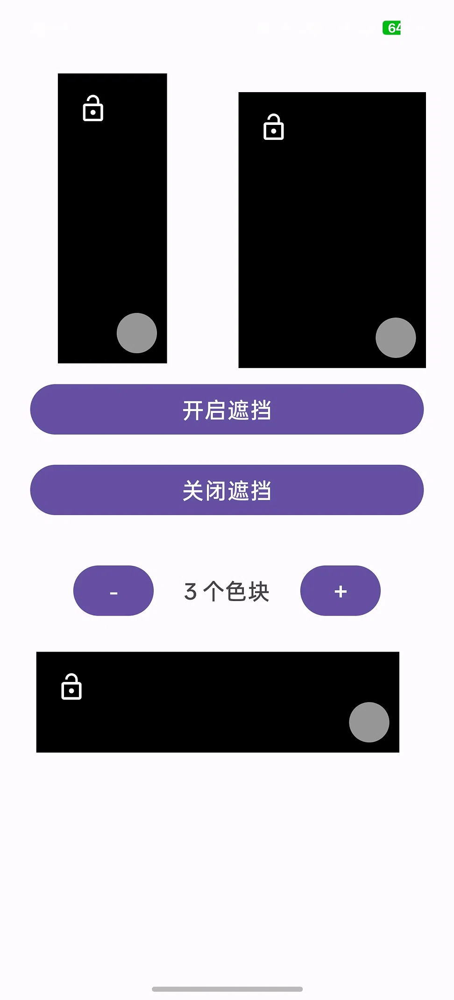
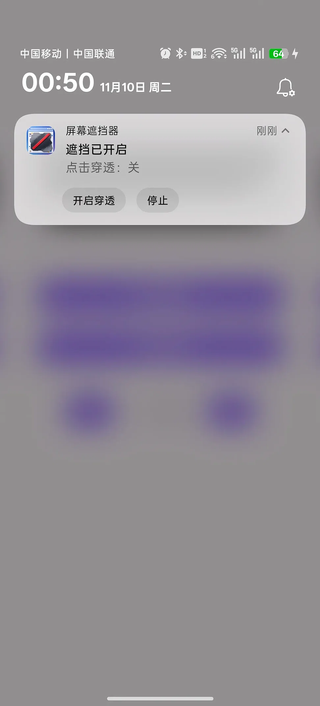
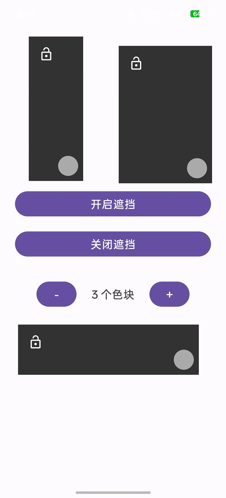

# 屏幕遮挡器 (Subtitle Blocker)

这是一个利用 Android 悬浮窗权限实现的屏幕信息遮挡软件。
主要用于看外语视频时，临时遮挡原生字幕或中文翻译，方便进行听力练习。
也可用于防止oled屏幕烧屏；音游遮挡掉落块等各种用法。

## ✨ 功能特点
- 创建可自由拖动、双向缩放（长/宽）的黑色遮挡块。
- 支持一键锁定，锁定后防误触且变为完全不透明。
- 支持多色块同时遮挡（最多6个），自动阶梯排列。
- 支持通知栏一键停止和点击穿透模式（穿透模式可以看到色块下的内容，并进行操作）。

## 🛠️ 如何安装
1. 下载项目右侧 Releases 中的 APK 文件（或者自己用 Android Studio 编译）。
2. 安装后，请在系统设置中授予“显示在其他应用上层（悬浮窗）”和“通知”权限。

## 📸 软件截图

| 通知栏控制 | 浅色模式 (3个色块) | 深色模式 |
| :---: | :---: | :---: |
|  |  |  |
